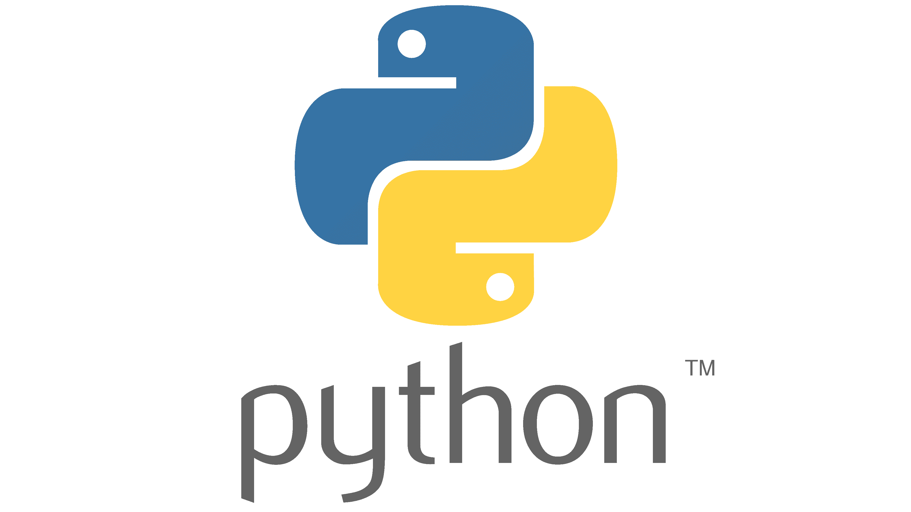

&nbsp;&nbsp;&nbsp;&nbsp;

# <bdi>Python for Data Science</bdi> | پایتون برای علوم داده

### <bdi>By: Dr. Hossein Haghbin</bdi> | دکتر حسین حق‌بین

###### هیئت علمی گروه آمار، دانشکده مهندسی سیستم های هوشمند و علوم داده، دانشگاه خلیج فارس

---

> 🎯 **هدف دوره:** یادگیری پایتون از پایه تا کسب مهارت‌های لازم برای ورود به دنیای یادگیری ماشین و یادگیری عمیق

> 📅 **ساختار دوره:** ۳۰ جلسه در ۳ بخش

> 🌐 **وبسایت درس:** [haghbinh.github.io/Python-Course](https://haghbinh.github.io/Python-Course/)

> 📥 <b><a href="https://haghbinh.github.io/Python-Course/pdf/Python-Course-All.pdf" download>دانلود PDF همه‌ی جلسات</a></b> — دکمه‌ی دانلود PDF هر جلسه هم در بالای صفحه‌ی همان جلسه است.

> 💡 برای اجرای جزوه‌ها، مخزن را با دکمه‌ی **Code → Download ZIP** دریافت کنید و فایل‌های پوشه‌ی `Notebooks` را در VS Code یا Jupyter باز کنید (راهنمای کامل در جلسه‌ی ۱).

---

### 🟢 بخش ۱: مبانی زبان پایتون | <bdi>Part 1: Python Fundamentals</bdi>
> 🎯 **هدف:** تبدیل منطق مسئله به کد درست و خوانا

| 🔢 جلسه | 🧑‍🏫 درس | 📝 عنوان انگلیسی | 📚 جزئیات | 🔗 لینک | 📓 نوت‌بوک | 📄 PDF |
|:---:|--------|-----------------|-----------------|:---:|:---:|:---:|
| 1 | معرفی و نصب محیط | Introduction & Setup | پایتون و علوم داده، نصب Python روی ویندوز، Jupyter Notebook، VS Code، دریافت جزوه‌ها، اولین برنامه و پیام خطا | [مشاهده](https://haghbinh.github.io/Python-Course/Notebooks/S01_Setup_Intro.html) | <a href="https://haghbinh.github.io/Python-Course/Notebooks/S01_Setup_Intro.ipynb" download>دانلود</a> | <a href="https://haghbinh.github.io/Python-Course/pdf/S01_Setup_Intro.pdf" download>دانلود</a> |
| 2 | انواع داده | Data Types | متغیرها و نام‌گذاری، اعداد صحیح و اعشاری (`int`, `float`)، رشته‌ها (`str`)، بولی (`bool`)، تبدیل نوع | [مشاهده](https://haghbinh.github.io/Python-Course/Notebooks/S02_Data_Types.html) | <a href="https://haghbinh.github.io/Python-Course/Notebooks/S02_Data_Types.ipynb" download>دانلود</a> | <a href="https://haghbinh.github.io/Python-Course/pdf/S02_Data_Types.pdf" download>دانلود</a> |
| 3 | عملگرها | Operators | عملگرهای ریاضی، عملگرهای مقایسه‌ای، عملگرهای منطقی، عملگرهای انتساب، اولویت عملگرها | [مشاهده](https://haghbinh.github.io/Python-Course/Notebooks/S03_Operators.html) | <a href="https://haghbinh.github.io/Python-Course/Notebooks/S03_Operators.ipynb" download>دانلود</a> | <a href="https://haghbinh.github.io/Python-Course/pdf/S03_Operators.pdf" download>دانلود</a> |
| 4 | ورودی و خروجی | Input / Output | تابع `print()`، تابع `input()`، f-string، متد `format()` | [مشاهده](https://haghbinh.github.io/Python-Course/Notebooks/S04_Input_Output.html) | <a href="https://haghbinh.github.io/Python-Course/Notebooks/S04_Input_Output.ipynb" download>دانلود</a> | <a href="https://haghbinh.github.io/Python-Course/pdf/S04_Input_Output.pdf" download>دانلود</a> |
| 5 | شرط‌ها | Conditionals | دستور `if`، `else` و `elif`، شرط‌های تودرتو، عبارت شرطی یک‌خطی | [مشاهده](https://haghbinh.github.io/Python-Course/Notebooks/S05_Conditionals.html) | <a href="https://haghbinh.github.io/Python-Course/Notebooks/S05_Conditionals.ipynb" download>دانلود</a> | <a href="https://haghbinh.github.io/Python-Course/pdf/S05_Conditionals.pdf" download>دانلود</a> |
| 6 | حلقه‌ها | Loops | حلقه‌ی `for`، تابع `range()`، حلقه‌ی `while`، `break` و `continue`، حلقه‌های تودرتو | [مشاهده](https://haghbinh.github.io/Python-Course/Notebooks/S06_Loops.html) | <a href="https://haghbinh.github.io/Python-Course/Notebooks/S06_Loops.ipynb" download>دانلود</a> | <a href="https://haghbinh.github.io/Python-Course/pdf/S06_Loops.pdf" download>دانلود</a> |
| 7 | توابع | Functions | تعریف تابع، پارامتر و مقدار بازگشتی، پارامترهای پیش‌فرض و نام‌دار، `*args` و `**kwargs`، دامنه‌ی متغیرها | [مشاهده](https://haghbinh.github.io/Python-Course/Notebooks/S07_Functions.html) | <a href="https://haghbinh.github.io/Python-Course/Notebooks/S07_Functions.ipynb" download>دانلود</a> | <a href="https://haghbinh.github.io/Python-Course/pdf/S07_Functions.pdf" download>دانلود</a> |
| 8 | لیست‌ها | Lists | ساخت لیست، اندیس‌گذاری و `slicing`، متدهای لیست، پیمایش لیست، لیست‌های تودرتو | [مشاهده](https://haghbinh.github.io/Python-Course/Notebooks/S08_Lists.html) | <a href="https://haghbinh.github.io/Python-Course/Notebooks/S08_Lists.ipynb" download>دانلود</a> | <a href="https://haghbinh.github.io/Python-Course/pdf/S08_Lists.pdf" download>دانلود</a> |
| 9 | تاپل‌ها و مجموعه‌ها | Tuples & Sets | تاپل و ویژگی‌های آن، unpacking، مجموعه (`set`)، عملیات روی مجموعه‌ها، کاربردها | [مشاهده](https://haghbinh.github.io/Python-Course/Notebooks/S09_Tuples_Sets.html) | <a href="https://haghbinh.github.io/Python-Course/Notebooks/S09_Tuples_Sets.ipynb" download>دانلود</a> | <a href="https://haghbinh.github.io/Python-Course/pdf/S09_Tuples_Sets.pdf" download>دانلود</a> |
| 10 | دیکشنری‌ها | Dictionaries | ساخت دیکشنری، دسترسی و به‌روزرسانی، متدهای دیکشنری، پیمایش دیکشنری، دیکشنری‌های تودرتو | [مشاهده](https://haghbinh.github.io/Python-Course/Notebooks/S10_Dictionaries.html) | <a href="https://haghbinh.github.io/Python-Course/Notebooks/S10_Dictionaries.ipynb" download>دانلود</a> | <a href="https://haghbinh.github.io/Python-Course/pdf/S10_Dictionaries.pdf" download>دانلود</a> |
| 11 | رشته‌ها | Strings | اندیس‌گذاری و `slicing` رشته، متدهای رشته، جست‌وجو و جایگزینی، `split` و `join`، قالب‌بندی رشته | [مشاهده](https://haghbinh.github.io/Python-Course/Notebooks/S11_Strings.html) | <a href="https://haghbinh.github.io/Python-Course/Notebooks/S11_Strings.ipynb" download>دانلود</a> | <a href="https://haghbinh.github.io/Python-Course/pdf/S11_Strings.pdf" download>دانلود</a> |
| 12 | پروژه‌ی ۱: تحلیل کارنامه‌ی دانشجویان | Project 1: Analyzing Student Transcripts | پاک‌سازی داده‌ی خام متنی، معدل وزنی، مشروطی و رتبه‌بندی، آمار درس‌ها و نمودار متنی، مقایسه‌ی ورودی‌ها، گزارش‌نویسی و دفاع | [مشاهده](https://haghbinh.github.io/Python-Course/Notebooks/S12_Project1.html) | <a href="https://haghbinh.github.io/Python-Course/Notebooks/S12_Project1.ipynb" download>دانلود</a> | <a href="https://haghbinh.github.io/Python-Course/pdf/S12_Project1.pdf" download>دانلود</a> |

---

### 🟡 بخش ۲: پایتون پیشرفته | <bdi>Part 2: Intermediate Python</bdi>
> 🎯 **هدف:** خواندن و فهم کد کتابخانه‌های علمی و نوشتن کد ساختاریافته

| 🔢 جلسه | 🧑‍🏫 درس | 📝 عنوان انگلیسی | 📚 جزئیات | 🔗 لینک | 📓 نوت‌بوک | 📄 PDF |
|:---:|--------|-----------------|-----------------|:---:|:---:|:---:|
| 13 | Comprehension و برنامه‌نویسی تابعی | Comprehensions & Functional Programming | list comprehension، dict و `set` comprehension، توابع `lambda`، `map` و `filter`، `zip` و `enumerate`، `sorted` با `key` | [مشاهده](https://haghbinh.github.io/Python-Course/Notebooks/S13_Comprehensions_Functional.html) | <a href="https://haghbinh.github.io/Python-Course/Notebooks/S13_Comprehensions_Functional.ipynb" download>دانلود</a> | <a href="https://haghbinh.github.io/Python-Course/pdf/S13_Comprehensions_Functional.pdf" download>دانلود</a> |
| 14 | Iterator، Generator و Decorator | Iterators, Generators & Decorators | iterable و iterator، تابع generator و `yield`، generator expression، مقدمه‌ای بر decorator | [مشاهده](https://haghbinh.github.io/Python-Course/Notebooks/S14_Iterators_Generators_Decorators.html) | <a href="https://haghbinh.github.io/Python-Course/Notebooks/S14_Iterators_Generators_Decorators.ipynb" download>دانلود</a> | <a href="https://haghbinh.github.io/Python-Course/pdf/S14_Iterators_Generators_Decorators.pdf" download>دانلود</a> |
| 15 | مدیریت خطا | Error Handling | انواع خطا، `try` و `except`، `else` و `finally`، `raise` | [مشاهده](https://haghbinh.github.io/Python-Course/Notebooks/S15_Error_Handling.html) | <a href="https://haghbinh.github.io/Python-Course/Notebooks/S15_Error_Handling.ipynb" download>دانلود</a> | <a href="https://haghbinh.github.io/Python-Course/pdf/S15_Error_Handling.pdf" download>دانلود</a> |
| 16 | کار با فایل | Working with Files | دستور `with`، فایل‌های متنی (`txt`)، فایل‌های `CSV`، فایل‌های `JSON`، ماژول `pathlib` | [مشاهده](https://haghbinh.github.io/Python-Course/Notebooks/S16_Files.html) | <a href="https://haghbinh.github.io/Python-Course/Notebooks/S16_Files.ipynb" download>دانلود</a> | <a href="https://haghbinh.github.io/Python-Course/pdf/S16_Files.pdf" download>دانلود</a> |
| 17 | ماژول‌ها و کتابخانه‌ی استاندارد | Modules & Standard Library | `import` و انواع آن، ساخت ماژول، `math` و `random`، `datetime`، `collections` | [مشاهده](https://haghbinh.github.io/Python-Course/Notebooks/S17_Modules_StdLib.html) | <a href="https://haghbinh.github.io/Python-Course/Notebooks/S17_Modules_StdLib.ipynb" download>دانلود</a> | <a href="https://haghbinh.github.io/Python-Course/pdf/S17_Modules_StdLib.pdf" download>دانلود</a> |
| 18 | شیءگرایی ۱ | Object-Oriented Programming I | کلاس و شیء، متد `__init__`، ویژگی‌ها، متدها | [مشاهده](https://haghbinh.github.io/Python-Course/Notebooks/S18_OOP_1.html) | <a href="https://haghbinh.github.io/Python-Course/Notebooks/S18_OOP_1.ipynb" download>دانلود</a> | <a href="https://haghbinh.github.io/Python-Course/pdf/S18_OOP_1.pdf" download>دانلود</a> |
| 19 | شیءگرایی ۲ | Object-Oriented Programming II | وراثت، بازنویسی متد (override)، متدهای ویژه (`__str__`، `__len__`، ...) | [مشاهده](https://haghbinh.github.io/Python-Course/Notebooks/S19_OOP_2.html) | <a href="https://haghbinh.github.io/Python-Course/Notebooks/S19_OOP_2.ipynb" download>دانلود</a> | <a href="https://haghbinh.github.io/Python-Course/pdf/S19_OOP_2.pdf" download>دانلود</a> |
| 20 | پروژه‌ی ۲: شبیه‌سازی صف بانک | Project 2: Bank Queue Simulation | پاک‌سازی لاگ نوبت‌دهی، تحلیل وضعیت فعلی شعبه، شبیه‌ساز شیءگرا با وراثت، مقایسه‌ی سیاست‌های صف، گزارش‌نویسی و دفاع | [مشاهده](https://haghbinh.github.io/Python-Course/Notebooks/S20_Project2.html) | <a href="https://haghbinh.github.io/Python-Course/Notebooks/S20_Project2.ipynb" download>دانلود</a> | <a href="https://haghbinh.github.io/Python-Course/pdf/S20_Project2.pdf" download>دانلود</a> |

---

### 🔵 بخش ۳: محاسبات علمی و کار با داده | <bdi>Part 3: Scientific Computing & Data Handling</bdi>
> 🎯 **هدف:** خواندن، پاک‌سازی، تحلیل و نمایش داده‌ی واقعی

| 🔢 جلسه | 🧑‍🏫 درس | 📝 عنوان انگلیسی | 📚 جزئیات | 🔗 لینک | 📓 نوت‌بوک | 📄 PDF |
|:---:|--------|-----------------|-----------------|:---:|:---:|:---:|
| 21 | NumPy ۱ | NumPy I | ساخت آرایه، `shape` و `dtype`، اندیس‌گذاری و `slicing`، `reshape` | [مشاهده](https://haghbinh.github.io/Python-Course/Notebooks/S21_NumPy_1.html) | <a href="https://haghbinh.github.io/Python-Course/Notebooks/S21_NumPy_1.ipynb" download>دانلود</a> | <a href="https://haghbinh.github.io/Python-Course/pdf/S21_NumPy_1.pdf" download>دانلود</a> |
| 22 | NumPy ۲ | NumPy II | برداری‌سازی، broadcasting، توابع آماری، اعداد تصادفی، جبر خطی | [مشاهده](https://haghbinh.github.io/Python-Course/Notebooks/S22_NumPy_2.html) | <a href="https://haghbinh.github.io/Python-Course/Notebooks/S22_NumPy_2.ipynb" download>دانلود</a> | <a href="https://haghbinh.github.io/Python-Course/pdf/S22_NumPy_2.pdf" download>دانلود</a> |
| 23 | Pandas ۱ | Pandas I | Series، DataFrame، خواندن `CSV` و Excel، `loc` و `iloc`، فیلتر کردن | [مشاهده](https://haghbinh.github.io/Python-Course/Notebooks/S23_Pandas_1.html) | <a href="https://haghbinh.github.io/Python-Course/Notebooks/S23_Pandas_1.ipynb" download>دانلود</a> | <a href="https://haghbinh.github.io/Python-Course/pdf/S23_Pandas_1.pdf" download>دانلود</a> |
| 24 | Pandas ۲ | Pandas II | مرتب‌سازی، `groupby` و تجمیع، `apply`، `pivot_table` | [مشاهده](https://haghbinh.github.io/Python-Course/Notebooks/S24_Pandas_2.html) | <a href="https://haghbinh.github.io/Python-Course/Notebooks/S24_Pandas_2.ipynb" download>دانلود</a> | <a href="https://haghbinh.github.io/Python-Course/pdf/S24_Pandas_2.pdf" download>دانلود</a> |
| 25 | Pandas ۳ | Pandas III | `concat`، `merge` و `join`، داده‌های زمانی | [مشاهده](https://haghbinh.github.io/Python-Course/Notebooks/S25_Pandas_3.html) | <a href="https://haghbinh.github.io/Python-Course/Notebooks/S25_Pandas_3.ipynb" download>دانلود</a> | <a href="https://haghbinh.github.io/Python-Course/pdf/S25_Pandas_3.pdf" download>دانلود</a> |
| 26 | پاک‌سازی و آماده‌سازی داده | Data Cleaning & Preparation | داده‌های گمشده، داده‌های پرت، تبدیل نوع، کدگذاری متغیرهای رسته‌ای، نرمال‌سازی و استانداردسازی | [مشاهده](https://haghbinh.github.io/Python-Course/Notebooks/S26_Data_Cleaning.html) | <a href="https://haghbinh.github.io/Python-Course/Notebooks/S26_Data_Cleaning.ipynb" download>دانلود</a> | <a href="https://haghbinh.github.io/Python-Course/pdf/S26_Data_Cleaning.pdf" download>دانلود</a> |
| 27 | مصورسازی با Matplotlib | Visualization with Matplotlib | نمودارهای پایه، `subplot`، شخصی‌سازی نمودار، ذخیره‌ی نمودار | [مشاهده](https://haghbinh.github.io/Python-Course/Notebooks/S27_Matplotlib.html) | <a href="https://haghbinh.github.io/Python-Course/Notebooks/S27_Matplotlib.ipynb" download>دانلود</a> | <a href="https://haghbinh.github.io/Python-Course/pdf/S27_Matplotlib.pdf" download>دانلود</a> |
| 28 | مصورسازی با Seaborn | Visualization with Seaborn | نمودارهای توزیع، نمودارهای رسته‌ای، همبستگی و `heatmap`، `pairplot` | [مشاهده](https://haghbinh.github.io/Python-Course/Notebooks/S28_Seaborn.html) | <a href="https://haghbinh.github.io/Python-Course/Notebooks/S28_Seaborn.ipynb" download>دانلود</a> | <a href="https://haghbinh.github.io/Python-Course/pdf/S28_Seaborn.pdf" download>دانلود</a> |
| 29 | تحلیل اکتشافی داده (EDA) | Exploratory Data Analysis | آمار توصیفی، آمار توصیفی با SciPy، مراحل EDA، EDA روی یک داده‌ی واقعی | [مشاهده](https://haghbinh.github.io/Python-Course/Notebooks/S29_EDA.html) | <a href="https://haghbinh.github.io/Python-Course/Notebooks/S29_EDA.ipynb" download>دانلود</a> | <a href="https://haghbinh.github.io/Python-Course/pdf/S29_EDA.pdf" download>دانلود</a> |
| 30 | پروژه‌ی پایانی: کیفیت هوای یک شهر | Final Project: Air Quality of a City | پاک‌سازی داده‌ی حسگرها، الگوهای زمانی آلودگی، آلودگی و هواشناسی، ارزیابی تعطیلی‌ها، گزارش‌نویسی و دفاع | [مشاهده](https://haghbinh.github.io/Python-Course/Notebooks/S30_Final_Project.html) | <a href="https://haghbinh.github.io/Python-Course/Notebooks/S30_Final_Project.ipynb" download>دانلود</a> | <a href="https://haghbinh.github.io/Python-Course/pdf/S30_Final_Project.pdf" download>دانلود</a> |

---
